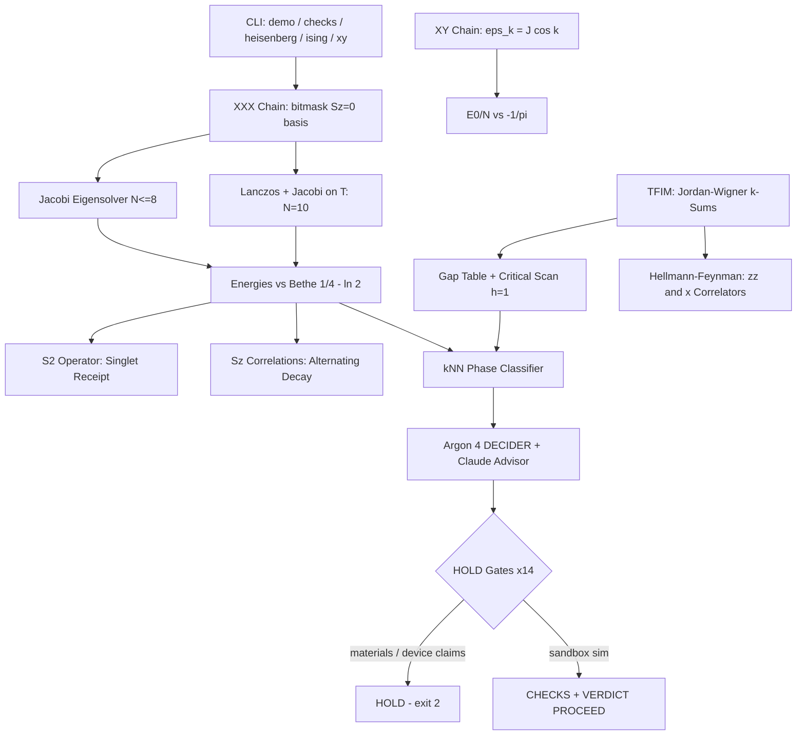
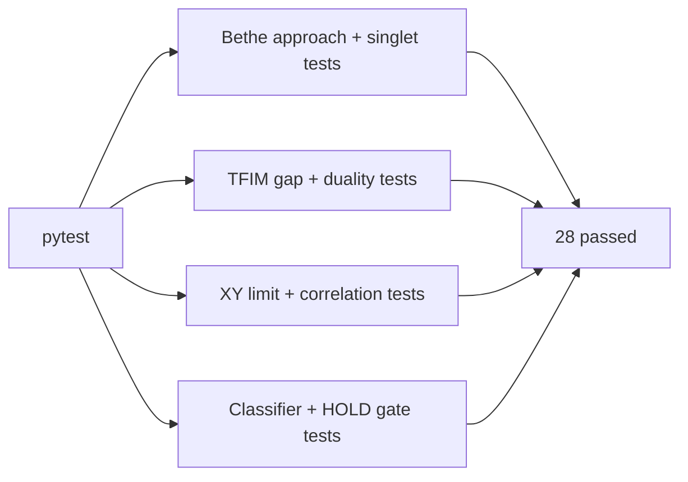
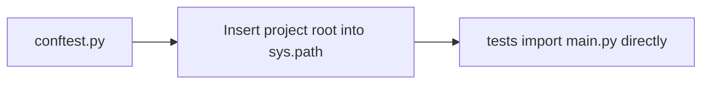
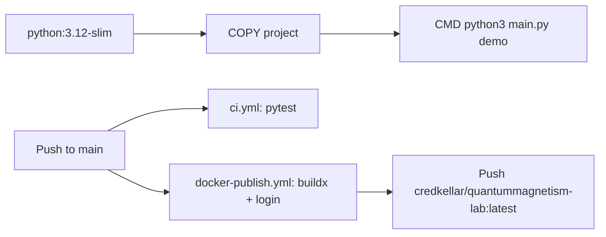

# QuantumMagnetism-Lab 🧲⚛️

**Quantum Magnetism Lab — Spin Chains, the Bethe Ansatz & the Ising Critical Point** — by Darion Kellar

QuantumMagnetism-Lab is an **educational quantum magnetism lab** in ONE pure-Python file. It computes the **exact ground states of small spin-1/2 chains** and grades every headline number against a known analytic result:

- **Heisenberg XXX antiferromagnet** — exact diagonalisation in the Sz = 0 sector (bitmask basis, from-scratch Jacobi eigensolver at N ≤ 8, Lanczos at N = 10): ground-state energies per site **−0.467129 (N = 6), −0.456387 (N = 8), −0.451545 (N = 10)**, rising toward the **Bethe-ansatz limit 1/4 − ln 2 = −0.443147** from below, exactly as the conformal finite-size correction −π²/12N² says they should. 🔬
- **A singlet with receipts** — the N = 8 and N = 10 ground states carry ⟨S²⟩ = 0 to machine precision, the nearest-neighbour correlator ⟨S_i·S_{i+1}⟩ is computed **two independent ways** (direct operator action vs energy bookkeeping) and they agree to <1e-9, and ⟨Sz_0 Sz_r⟩ **alternates in sign and decays** with distance. 🧲
- **Transverse-field Ising chain by Jordan–Wigner** — free-fermion spectrum ε_k = 2√(1 + h² − 2h·cos k): the gap **closes at h = 1** (4 sin(π/2N) = 0.196271 at N = 32, located by an independent grid scan), the critical energy approaches **−4/π**, and at h = 1 the duality ⟨σzσz⟩ = ⟨σx⟩ = **2/π** is reproduced by the finite sums. ⚡
- **XY chain as a cross-check** — the same Jordan–Wigner machinery with ε_k = J·cos k walks E0/N down to **−1/π = −0.318310** (error 3.2e-5 at N = 128). 🎯

Honest scope, stated up front: a finite chain **approaches** the thermodynamic limit — it never reaches it, and it is **not a material**. No material was discovered, no magnet was designed, no sample was measured. Every real-world materials / device / measurement claim sits behind a permanent HOLD gate (14 total). 🔒

[](https://github.com/kimanicollier44-cmyk/QuantumMagnetism-Lab/actions/workflows/ci.yml)
[](https://github.com/kimanicollier44-cmyk/QuantumMagnetism-Lab/actions/workflows/docker-publish.yml)

> ℹ️ These are the **live** workflow badges for this repo. They activate as soon as the `ci.yml` and `docker-publish.yml` files from the paste pack are pasted into `.github/workflows/` — until then they have nothing to report yet.

## 🧰 Tech Stack Badges & Full Architecture Tech Stack

### 💻 Core Programming Languages & Core Systems


- 🐍 Python 3.12, pure standard library (`math`, `hashlib`, `json`, `sys`) — zero dependencies, zero network, deterministic (double-run byte-identical)
- 🧲 Exact-diagonalisation core from scratch: bitmask Sz = 0 basis (dims 6 / 20 / 70 / 252), a cyclic **Jacobi eigensolver** written out in full for the dense Hamiltonians, and a **Lanczos** iteration with full reorthogonalisation against the sparse Hamiltonian action for N = 10 — the two methods are asserted to agree at N = 8 in CHECKS
- ⚡ Jordan–Wigner free-fermion core: TFIM spectrum ε_k = 2√(J² + h² − 2Jh·cos k) on the antiperiodic momenta k = (2m+1)π/N, ground energy as the k-sum −½Σε_k, correlators by **Hellmann–Feynman** centred differences of that exact sum; XY chain ε_k = J·cos k as the cross-check
- 🎯 Graded against exact results, not other simulations: Bethe ansatz 1/4 − ln 2, XY −1/π, TFIM critical −4/π and 2/π duality, gap 4 sin(π/2N), the soluble N = 4 ring (E0 = −2), the ferromagnet's S(S+1) = 20
- 🧠 TinyML kNN phase classifier (from scratch, stdlib, distance-weighted): antiferromagnetic / ferromagnetic / critical / paramagnetic-disordered from correlator + gap + magnetisation, labels from the lab's own policy
- 🪑 Council seats: Gemini Argon 4 DECIDER (names-only, tighten-only) + Muse advisor (never overrides HOLD) + Google Flow plan-only (rendered = False, live = 0)

### ⛓️ Web3 & Infrastructure

- 🚫 **Not applicable — honestly.** No blockchain, no Web3, no tokens: the "infrastructure" in this lab is one offline file holding a bitmask basis, a Jacobi solver, and two Jordan–Wigner k-sums. Materials and device claims are permanent HOLD gates, not features. No fake badges here.

### ⚙️ Platform Support & Hardware Architecture


- 🖥️ Pure Python — runs anywhere Python 3.12+ runs (Linux, macOS, Windows), plus the `python:3.12-slim` Docker image
- 🔒 No hardware is controlled, ever: real magnets, cryostats, samples, and spectrometers are permanent HOLD gates (see the gate table below)

### ⚡ Low-Level Infrastructure & Performance

- 🚫 **No low-level code — honestly.** No C, no C++, no GPU, no compiled extensions: this is one interpreted Python file on purpose, so every eigenvalue can be read, checked, and diffed. Performance here means honest algorithms — a 252-dimensional Lanczos with full reorthogonalisation instead of a dense 252×252 diagonalisation, and closed-form k-sums instead of diagonalising the Ising chain at all — all deterministic and byte-identical between runs.

### 🛠️ DevOps & Build Tools


- 🐳 Docker (`python:3.12-slim`), GitHub Actions CI + Docker Publish (delivered in the paste pack)
- 🎯 Target image: `credkellar/quantummagnetism-lab:latest`
- 🧪 Tests: `pytest` (28 tests) + the built-in CHECKS suite (45 checks) in `main.py`

### ☁️ Cloud Providers

- 🚫 **None — honestly.** No cloud provider is used or needed: the lab runs fully offline on your own machine or in a local Docker container. Docker Hub appears only as the registry the publish workflow pushes the image to.

## What this does?

1. 🧲 **Builds the Heisenberg XXX ring in the Sz = 0 sector** — basis states are bitmasks with exactly N/2 spins up (dims 6, 20, 70, 252 for N = 4, 6, 8, 10); the Hamiltonian is assembled from the Sz·Sz diagonal (±1/4 per bond) and the flip-flop off-diagonal (J/2 between antiparallel neighbours), periodic boundary included.
2. 🔢 **Diagonalises it two ways** — a from-scratch cyclic Jacobi eigensolver takes the dense matrices at N ≤ 8; at N = 10 a Lanczos iteration with full reorthogonalisation drives the sparse Hamiltonian action and a Jacobi solve of the small tridiagonal. CHECKS assert the two methods agree at N = 8 to <1e-9 — the solver grades itself.
3. 🎯 **Grades the energies against Bethe** — E0/N = −0.500000 (N = 4, exactly soluble: E0 = −2), −0.467129, −0.456387, −0.451545 — every finite ring **below** the Bethe-ansatz limit 1/4 − ln 2 = −0.443147 and rising toward it, the conformal −π²/12N² correction made visible. N = 10 lands within 0.0084 of the limit.
4. 🌀 **Proves the ground state is a singlet** — the S² operator (diagonal SzSz part + pair-flip part) is applied to the computed ground states: ⟨S²⟩ ≈ −3.1e-18 at N = 8 and ≈ −8.5e-17 at N = 10 — zero to machine precision, asserted <1e-9 in CHECKS.
5. ⚖️ **Computes the bond correlator twice** — ⟨S_i·S_{i+1}⟩ by direct operator action on the ground state, and independently from E0/N (translation invariance / Hellmann–Feynman bookkeeping). Both give −0.456387 at N = 8 and −0.451545 at N = 10; agreement is a check, not an assumption.
6. 📉 **Prints the correlation fingerprint** — ⟨Sz_0 Sz_r⟩ for r = 0..4 at N = 8: +0.250000, −0.152129, +0.065259, −0.062984, +0.049708. Signs alternate (antiferromagnetic correlation), magnitudes decay (quasi-long-range order — no true Néel order in 1D), and the SU(2) identity ⟨SzSz⟩ = ⟨S·S⟩/3 at r = 1 is asserted exactly.
7. 🧭 **Runs the ferromagnet as the opposite extreme** — at J = −1 the same machinery finds E0 = −2 = −N/4 exactly, ⟨S²⟩ = 20 = S(S+1) with S = N/2 (the fully symmetric Dicke multiplet), and every bond at +1/4 — the maximally polarised mirror of the singlet.
8. ⚡ **Solves the transverse-field Ising chain by Jordan–Wigner** — ε_k = 2√(1 + h² − 2h·cos k) over k = (2m+1)π/N, E0 = −½Σε_k: exact −N at h = 0, and at h = 1 the energies −1.275287 / −1.273751 / −1.273367 (N = 16 / 32 / 64) closing on −4/π = −1.273240.
9. 🎯 **Locates the critical point three ways** — the gap table (2.000000 at h = 0, 0.196271 at h = 1, 4.014420 at h = 3), the closed form gap(h = 1) = 4 sin(π/2N) matched to machine precision, and an independent scan of h ∈ [0.50, 1.50] whose argmin is exactly h = 1.00. At criticality the Hellmann–Feynman correlators give ⟨zz⟩ = ⟨x⟩ = 0.636876 — the self-duality value 2/π = 0.636620, from finite sums.
10. 🔀 **Cross-checks with the XY chain, then classifies** — ε_k = J·cos k fills the negative modes: E0/N = −0.320364 → −0.318342 (N = 16 → 128) approaching −1/π from below. Finally a from-scratch distance-weighted kNN labels eight computed ground states antiferromagnetic / ferromagnetic / critical / paramagnetic-disordered, with labels from the lab's own policy — asserted equal to the policy on every scenario and all 350 training-grid rows.

## 🗺️ How it works — diagram per script

### `main.py` — the whole lab



### `tests/test_main.py` — verification



### `conftest.py` — test path setup



### `Dockerfile` + CI flow — container & publish



## Why is this cool?

1. 🎯 The Bethe ansatz is a **grading target, not a citation**: the lab diagonalises chains itself and watches −0.467129 → −0.456387 → −0.451545 climb toward 1/4 − ln 2 = −0.443147, finite-size correction and all.
2. 🌀 The singlet is **proved, not presumed**: ⟨S²⟩ comes out at 1e-18 — the lab applies the total-spin operator to its own ground state and shows the zero.
3. ⚖️ Every correlator has **two independent derivations** that must agree — operator action vs energy bookkeeping for the XXX bond, Hellmann–Feynman differences vs the 2/π duality for the Ising chain.
4. 🔢 The eigensolver is **written out in full** — cyclic Jacobi rotations and a reorthogonalised Lanczos, no library diagonalisation anywhere — and the two methods cross-grade at N = 8 to <1e-9.
5. 🎯 The critical point is found **three independent ways**: gap table, closed form 4 sin(π/2N), and a blind grid scan whose argmin lands exactly on h = 1.00.
6. 🪞 The ferromagnet is the singlet's mirror image in the same code: flip J's sign and out comes S = N/2, ⟨S²⟩ = 20, every bond +1/4 — one sign, two opposite worlds.
7. 📉 The correlation table is the **fingerprint of 1D antiferromagnetism**: alternating signs, decaying magnitudes, quasi-order without Néel order — read straight off the exact ground state.
8. 🔀 Jordan–Wigner does double duty: one fermionisation solves the Ising chain *and*, re-dressed as ε_k = J·cos k, the XY chain — two models, one machinery, two exact limits (−4/π and −1/π) both reproduced.
9. 🧲 It teaches the **honest direction of approach**: finite XXX chains sit *below* the Bethe limit and rise; XY sums sit below −1/π and rise; the Ising critical energy closes from below too — "approaches" always comes with a sign and a rate.
10. 🎯 Deterministic end to end: run it twice, get byte-identical output — a magnetism lab you can diff.

## What problems this solves?

1. ❌ **Problem:** "The ground-state energy is −0.4431 per site" gets quoted for chains of any size. ✅ **Solution:** The lab shows the finite-N values (−0.451545 at N = 10) and the exact limit side by side, with the approach asserted in CHECKS — the limit is a limit, not a small-chain result.
2. ❌ **Problem:** Textbook statements like "the XXX ground state is a singlet" are rarely demonstrated. ✅ **Solution:** S² is applied to the computed state as an operator; the zero is measured to machine precision at two sizes.
3. ❌ **Problem:** Correlators are often pulled from a single formula with no cross-check. ✅ **Solution:** The bond correlator is computed by operator action *and* by energy bookkeeping; the Ising correlators by finite differences of the exact sum, refereed by the duality value 2/π.
4. ❌ **Problem:** Black-box eigensolvers hide whether a "ground state" is even converged. ✅ **Solution:** Two from-scratch methods (Jacobi, Lanczos) must agree at N = 8 before any N = 10 number is trusted.
5. ❌ **Problem:** The TFIM critical point is usually just asserted to be h = 1. ✅ **Solution:** A blind scan over h finds the gap minimum at exactly 1.00, the gap matches 4 sin(π/2N), and the duality ⟨zz⟩ = ⟨x⟩ shows up in the same table.
6. ❌ **Problem:** Jordan–Wigner is presented as a trick that works for one model. ✅ **Solution:** The same momenta and filling logic solve the XY chain too, graded against a second exact limit (−1/π).
7. ❌ **Problem:** "Antiferromagnetic correlations" stay abstract. ✅ **Solution:** The ⟨Sz_0 Sz_r⟩ table shows the alternation and decay numerically, with the SU(2) factor-of-3 identity checked exactly.
8. ❌ **Problem:** Phase labels get attached to models by vibe. ✅ **Solution:** A policy + kNN classifier labels eight computed ground states from measured features (correlator, gap, magnetisation) — and the paramagnetic side (h = 2, 3) is *not* mislabelled ferromagnetic, because the gap feature vetoes it.
9. ❌ **Problem:** Spin-chain demos quietly imply a material or a device is next. ✅ **Solution:** 14 named HOLD gates return exit code 2 for every materials-discovery, magnet-design, sensor, storage, or measurement claim, forever.
10. ❌ **Problem:** Simulation numbers drift between runs and machines. ✅ **Solution:** Pure stdlib, fixed deterministic Lanczos start vector, no RNG, no wall clock — double-run output is byte-identical and asserted in the test suite.

## How to install this?

1. 📋 Clone or download this project folder.
2. 🐍 Make sure Python 3.12+ is installed: `python3 --version`
3. ▶️ Run the full demo + checks (no arguments needed):

```bash
python3 main.py
```

4. 🧪 Run the test suite:

```bash
pip install pytest
python3 -m pytest -q
```

5. 🎛️ Try the other commands:

```bash
python3 main.py checks        # 45 built-in checks
python3 main.py heisenberg    # XXX energies vs Bethe + ferromagnet (JSON)
python3 main.py ising         # TFIM gap table + critical scan (JSON)
python3 main.py xy            # XY chain approach to -1/pi (JSON)
python3 main.py correlations  # <Sz_0 Sz_r> table, N = 8 (JSON)
python3 main.py phases        # phase features + policy/kNN verdicts (JSON)
python3 main.py classify      # kNN phase classifier report
python3 main.py brains        # Argon 4 + Muse + Flow seats
python3 main.py holds         # list all 14 HOLD gates
python3 main.py hold-demo     # exits 2 - gated actions stay HOLD
```

6. 🐳 Or run it in Docker:

```bash
docker build -t credkellar/quantummagnetism-lab:latest .
docker run --rm credkellar/quantummagnetism-lab:latest
```

## Requirements

- 🐍 Python 3.12 or newer
- 📦 Dependencies: **none** (standard library only)
- 🌐 Network: **none** — fully offline
- 🧪 For tests only: `pytest`
- 🐳 Optional: Docker

## FULL project structure tree

```text
quantummagnetism-lab/
├── main.py                  # the whole lab: XXX exact diagonalisation (Jacobi + Lanczos), S^2 + correlators, TFIM + XY via Jordan-Wigner, classifier, seats, HOLD gates
├── conftest.py              # puts the project root on sys.path for tests
├── tests/
│   └── test_main.py         # 28 pytest tests: Bethe approach, singlet, duality, XY limit, classifier, gates, determinism
├── assets/
│   └── cover.png            # README cover image (2736 x 912)
├── Dockerfile               # python:3.12-slim, runs the demo
├── .gitignore               # __pycache__/, .pytest_cache/, *.pyc
└── README.md                # this file
```

> 📦 Delivered separately as paste packs (not in this tree): `.github/workflows/ci.yml` + `docker-publish.yml`, and the Docker Hub pack (100-char description, 350-char About, overview, categories).

## 🔒 HOLD gates — all 14, permanent

| # | Gate | What stays held |
|---|------|-----------------|
| 1 | `materials_discovery_claim` | No claim of discovering or predicting a real material from a spin-chain model |
| 2 | `magnet_design_claim` | No designing real magnets, magnet assemblies, or magnetic devices |
| 3 | `spintronic_device_claim` | No spintronic, MRAM, or spin-device design or performance claims |
| 4 | `medical_magnet_claim` | No MRI, medical magnet, or clinical magnetic-system claims |
| 5 | `fusion_magnet_claim` | No superconducting, fusion, or accelerator magnet engineering claims |
| 6 | `vendor_hardware_claim` | No vendor hardware claims; no commercial magnet or cryostat is endorsed |
| 7 | `hardware_spec_claim` | No real-product specifications (field strength, Tc, coercivity) from lab numbers |
| 8 | `real_sample_measurement_claim` | No claim that a real sample, crystal, or compound was measured |
| 9 | `quantum_hardware_claim` | No quantum-computer hardware, qubit, or annealer claims from a chain model |
| 10 | `sensor_product_claim` | No magnetometer or magnetic-sensor product claims |
| 11 | `data_storage_claim` | No magnetic data-storage density or media claims |
| 12 | `energy_application_claim` | No magnetic energy-storage, motor, or generator application claims |
| 13 | `investment_claim` | No investment claims; a teaching model is not a prospectus |
| 14 | `critical_point_measurement_claim` | Computed critical points are exact model values, not measurements of any real material's transition |

🧑‍⚖️ **Council seats:** Gemini Argon 4 Extended Thinking — DECIDER (names-only, tighten-only, MAP → MODEL → STRESS → DECIDE, sha256 trace, `can_override_hold = False`) · Muse — advisor (`can_override_hold = False`) · Google Flow — plan-only (`rendered = False`, `live = 0`).

✅ **Verification:** pytest **28 passed** (project + clean copy) · built-in CHECKS **45/45** · double-run output **byte-identical** · `hold-demo` exits **2** · `main.py` **904 lines**, pure stdlib, zero network.

## 🧒 5th-grade English section

Imagine a ring of tiny magnets, like a necklace of compass needles. Each needle wants to point **opposite** to its neighbours — up, down, up, down. But in the quantum world they can't all be happy at once, so they settle into a special shared pattern. 🧲

- This lab builds that necklace on a computer — 4, 6, 8, then 10 magnets — and finds its **lowest-energy pattern exactly**, no guessing. A famous math result (the **Bethe ansatz**) says what the energy would be for an *endless* necklace: about −0.4431 per magnet. The lab's necklaces get closer and closer: −0.4671, −0.4564, −0.4515 — always a little below, climbing up toward the endless answer. 📈
- The pattern the magnets choose has **no favourite direction at all** — add up all their pointing and you get exactly zero. The lab *checks* that zero with its own math, like weighing something to prove the scale says nothing. 🌀
- Neighbours still "feel" each other: if one points up, the next leans down, the next up — a fading echo as you walk around the ring: strong nearby, weaker far away. The lab prints that echo as a table of numbers. 📉
- Then the lab swaps the necklace for a different game: magnets that line up in a row, with a sideways field trying to flip them. At one **exact** field strength the row can't decide which way to be — that's a **critical point**, and the lab finds it three different ways, like measuring a table with three rulers and getting the same answer. 📏
- This project is a **pretend lab on a computer**. It does not discover real materials or build real magnets. It teaches how tiny magnets agree, disagree, and change their minds — with every number checked against an answer mathematicians already know. 💻

---

MIT © 2026 Darion Kellar · QuantumMagnetism-Lab — educational simulation only 🧲
